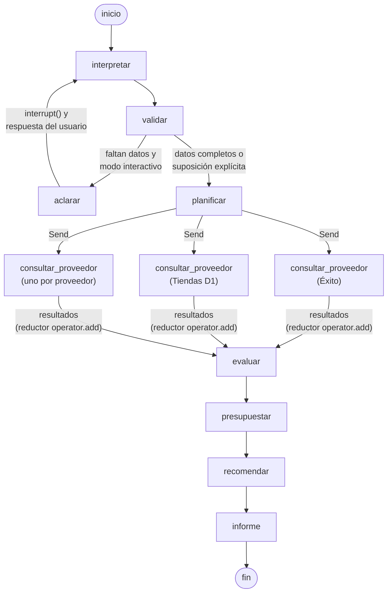

# Presupuesto de mercado con LangGraph

Aplicación basada en **LangGraph** y **LangChain** que recibe una solicitud de compra en lenguaje natural, consulta precios en supermercados colombianos, compara alternativas y elabora un presupuesto sustentado en fuentes verificables.

- **Dominio:** mercado (alimentos, aseo y artículos del hogar).
- **Proveedores:** Éxito, Carulla, Jumbo, Tiendas D1 y Olímpica, consultados en línea con Playwright. Los comercios sin precios en línea (por ejemplo, Tiendas Ara) se admiten mediante un catálogo de referencia importado.

```text
$ uv run presupuesto-mercado "Necesito 5 kg de arroz, 2 litros de aceite y 3 kg de azúcar. \
    Consulta dos supermercados y prepara un presupuesto para Medellín."
```

En `ejemplos/` se incluyeron informes reales generados por el sistema, junto con su evidencia en JSON.

## Arquitectura del DAG

El flujo se implementó como un `StateGraph` de LangGraph (`src/presupuesto_mercado/grafo.py`). Es un grafo dirigido acíclico, con una sola excepción acotada: el ciclo de aclaración `aclarar → interpretar`, que se recorre como máximo una vez y solo en modo interactivo. Sin modo interactivo, el grafo es estrictamente acíclico.



El diagrama que LangGraph genera a partir del grafo compilado se obtiene con:

```bash
uv run python -c "from presupuesto_mercado.grafo import grafo; print(grafo.get_graph().draw_mermaid())"
```

### Nodos

| Nodo | Qué hace | LLM / reglas |
|---|---|---|
| `interpretar` | Convierte el texto en una `Solicitud`: producto, cantidad, unidad, marca (preferida u obligatoria), presentación, atributos, exclusiones, ciudad, proveedores pedidos y costos que el usuario conoce. | LLM con salida estructurada (Pydantic); intérprete por reglas como respaldo |
| `validar` / `aclarar` | Detecta datos imprescindibles faltantes (cantidad, unidad, ciudad). En modo interactivo pausa el grafo con `interrupt()` (human-in-the-loop); si no, registra una suposición explícita. | Reglas |
| `planificar` | Resuelve qué proveedores consultar (mínimo dos) y registra los que no tienen precios en línea. Si se piden "N supermercados" sin nombrarlos, se consultan todos y se marca cuántos presentar. | Reglas |
| `consultar_proveedor` | Una rama paralela por proveedor (`Send`). Ubica la categoría en el sitemap, renderiza el listado con Playwright y extrae nombre, presentación, precio, moneda, URL, SKU, disponibilidad, vendedor y fecha de consulta. | Playwright |
| `evaluar` | Clasifica cada resultado como **equivalente**, **sustituto aproximado**, **no comparable** o **no relacionado**, y normaliza unidades y precio por kg/L/und. | LLM para la equivalencia; reglas para la comparabilidad, que el LLM no puede saltarse |
| `presupuestar` | Elige la combinación de empaques más barata que cubre cada cantidad, arma un presupuesto por proveedor y una compra combinada, se queda con los N mejores si se pidieron N supermercados y aplica la regla de recomendación. | Reglas (aritmética auditable) |
| `recomendar` | Redacta la explicación de la opción ya elegida, sin cambiar números. | LLM; texto por reglas como respaldo |
| `informe` | Genera el informe Markdown y la evidencia JSON. | Reglas |

### Aristas

| Tipo | Dónde | Funcionamiento |
|---|---|---|
| Secuencial | `interpretar → validar`, `evaluar → presupuestar → recomendar → informe` | `add_edge`: el siguiente nodo se ejecuta al terminar el anterior. |
| Condicional | `validar → aclarar \| planificar` | `ruta_validacion` envía a `aclarar` solo si faltan datos, el modo es interactivo y aún no se aclaró. En otro caso, `planificar` registra una suposición explícita y continúa. |
| Fan-out dinámico | `planificar → consultar_proveedor` | `repartir_consultas` devuelve un `Send` por proveedor con un estado propio (`EstadoConsulta`: proveedor, solicitud y opciones). Las ramas se ejecutan en paralelo en el mismo superpaso, y su número depende de los proveedores elegidos. |
| Fan-in | `consultar_proveedor → evaluar` | `evaluar` espera a que terminen todas las ramas. El reductor `operator.add` de `resultados` concatena lo que devuelve cada una. |
| Ciclo acotado | `aclarar → interpretar` | `aclarar` llama a `interrupt()` con las preguntas. Al reanudar con `Command(resume=respuesta)`, la respuesta se agrega al texto, se marca `aclarado=True` y se vuelve a interpretar. La marca impide una segunda pausa. |

### Estado compartido

El estado es un `TypedDict` (`Estado`). Los campos con reductor acumulan lo que escriben varios nodos o ramas; los demás se reemplazan.

| Campo | Lo escribe | Reductor |
|---|---|---|
| `texto`, `opciones` | entrada; `aclarar` agrega la aclaración a `texto` | reemplazo |
| `solicitud` | `interpretar`; `planificar` y `presupuestar` le agregan suposiciones | reemplazo |
| `preguntas`, `aclarado` | `validar`, `aclarar` | reemplazo |
| `proveedores`, `presentar`, `nombres`, `mecanismos` | `planificar` | reemplazo |
| `resultados` | cada rama de `consultar_proveedor` | `operator.add` |
| `evaluadas` | `evaluar` | reemplazo |
| `presupuestos`, `combinado`, `decision` | `presupuestar` | reemplazo |
| `recomendacion`, `informe` | `recomendar`, `informe` | reemplazo |
| `avisos` | cualquier nodo (fallas del LLM, uso de reglas) | `operator.add` |

### Persistencia y recursos

- **Checkpointer:** el grafo se compila con un checkpointer en memoria (`crear_checkpointer()`), que registra de forma explícita los modelos Pydantic del estado. Cada ejecución usa un `thread_id`: uno por solicitud en la CLI y uno por conversación en Telegram. Eso permite pausar con `interrupt()` y reanudar el mismo hilo.
- **Recursos no serializables:** el navegador de Playwright y el modelo de lenguaje no viajan en el estado. Se inyectan por `config["configurable"]`, y así el estado se puede guardar en el checkpoint.
- **LangGraph Studio:** el módulo expone `grafo` (sin checkpointer, porque el servidor aporta el suyo), registrado en `langgraph.json`.

Las decisiones de diseño y las alternativas descartadas se documentaron en [`docs/decisiones.md`](docs/decisiones.md).

### Estructura del código

```text
src/presupuesto_mercado/
├── grafo.py            # StateGraph: nodos, aristas, fan-out con Send, interrupt
├── interpretacion.py   # LLM con salida estructurada + intérprete por reglas + validación
├── emparejamiento.py   # equivalente / sustituto / no comparable (LLM + reglas)
├── presupuesto.py      # selección de empaques, presupuestos, compra combinada, recomendación
├── unidades.py         # g↔kg, mL↔L, libra (500 g), docena, multipacks, presentaciones
├── navegador.py        # Playwright, robots.txt, caché, cortesía, detección de bloqueos
├── robots.py           # robots.txt con comodines (* y $)
├── reporte.py          # informe Markdown
├── modelos.py          # modelos Pydantic compartidos
├── llm.py              # creación del modelo (Claude por defecto, configurable)
├── cli.py              # interfaz de línea de comandos
├── telegram.py         # bot de Telegram (long polling) sobre el mismo grafo
└── proveedores/
    ├── base.py         # descubrimiento de categorías por sitemap y paginación
    ├── grupo_exito.py  # Éxito y Carulla (DOM)
    ├── jumbo.py        # Jumbo (DOM)
    ├── vtex_jsonld.py  # D1 y Olímpica (JSON-LD schema.org)
    └── catalogo.py     # catálogos CSV/JSON/Excel (comercios sin precios en línea)
```

## Cómo se obtienen los precios

No se usa ninguna API privada ni el buscador interno de las tiendas: sus `robots.txt` prohíben `/api/`, `/s?`, `/busca` y los parámetros de búsqueda. El sistema lee los **sitemaps públicos de categorías** y abre la página de la categoría del producto (por ejemplo `exito.com/mercado/despensa/granos-y-arroz`) con **Playwright**, que ejecuta el JavaScript igual que un navegador. Después extrae los productos así:

- **D1 y Olímpica:** desde los datos estructurados schema.org (`ItemList` → `Product` → `Offer`).
- **Éxito, Carulla y Jumbo:** desde las tarjetas de producto del DOM.

Los sitemaps también se descargan con Chromium: Éxito responde 403 a los clientes HTTP que no son navegadores, aunque la ruta esté permitida en `robots.txt`.

Antes de cada solicitud se verifica `robots.txt`. Entre solicitudes al mismo dominio se espera un intervalo y los resultados se guardan en caché. Si varias consultas necesitan la misma página a la vez, se descarga una sola vez. Las fallas transitorias de red (tiempo agotado, `net::ERR_…`) se reintentan hasta tres veces con espera creciente. Si un sitio responde con un bloqueo (403, 429 o página de verificación), se deja de consultar durante 30 minutos y el informe lo registra como "no se pudo consultar", distinto de "sin oferta equivalente".

Cada oferta conserva: nombre, marca, presentación, contenido normalizado, precio general, precio de lista, precio condicionado (tarjeta), moneda, proveedor, URL del producto, URL del listado, SKU, fecha de consulta, disponibilidad, vendedor y tipo de fuente.

## Qué entrega el informe

1. La interpretación de la solicitud y las suposiciones explícitas.
2. Una tabla por producto con todas las ofertas encontradas, su clasificación y el motivo, el precio por kg/L/und, la disponibilidad y el enlace.
3. Un presupuesto por proveedor ("compra completa" o "compra parcial", según cubra o no toda la lista) y una compra combinada (mejor precio por producto), cuando es viable. Los proveedores sin ningún producto cotizado no se presentan como opción.
4. Un resumen comparativo con **subtotal de productos** y **total final confirmado**. El total queda "no confirmado" mientras el envío no se conozca: un envío desconocido nunca se toma como cero.
5. Los productos sin cotización, separando "no se pudo consultar" (falla del sitio o de la red) de "sin oferta equivalente", y las incidencias de consulta.
6. Las condiciones no verificadas: precio por ciudad, cobertura de entrega, precios con tarjeta, disponibilidad no publicada.
7. La recomendación explicada. Si ninguna opción cubre la lista completa, no se recomienda ninguna y solo se indica la de mayor cobertura como referencia.
8. Las fuentes consultadas, con fecha y número de productos leídos, y el mecanismo usado por proveedor.

## Instalación

Se requieren Python 3.12+ y [uv](https://docs.astral.sh/uv/).

```bash
uv sync
uv run playwright install chromium
cp .env.example .env   # y se completa ANTHROPIC_API_KEY
```

Sin credenciales de LLM el sistema funciona igual, con reglas heurísticas, y lo advierte en el informe.

## Uso

```bash
# Solicitud libre: si no se nombran supermercados se consultan los cinco
# ("consulta dos supermercados" también consulta los cinco y presenta los dos mejores)
uv run presupuesto-mercado "Necesito 30 huevos AA, 6 litros de leche entera y 2 kg de arroz Diana (solo Diana) en Bogotá"

# Proveedores explícitos y aceptación de sustitutos cuando no hay equivalentes
uv run presupuesto-mercado "2 kg de azúcar morena y 1 kg de café" --proveedores d1,olimpica --aceptar-sustitutos

# Modo interactivo: el grafo se detiene y pregunta si falta un dato imprescindible
uv run presupuesto-mercado "Necesito arroz y aceite" --interactivo

# Comercio sin precios en línea (Tiendas Ara) mediante un catálogo de referencia
uv run presupuesto-mercado "5 kg de arroz y 2 L de aceite en Barranquilla" --catalogo ara=datos/catalogos/ara.csv
```

| Opción | Efecto |
|---|---|
| `--proveedores` | Lista de proveedores (`exito,carulla,jumbo,d1,olimpica`); anula la que venga en la solicitud. |
| `--catalogo ID=RUTA` | Agrega un proveedor a partir de un CSV/JSON/Excel con las columnas de [`datos/catalogos/plantilla.csv`](datos/catalogos/plantilla.csv). |
| `--interactivo` | Pide aclaraciones en lugar de suponer. |
| `--aceptar-sustitutos` | Usa sustitutos cuando no hay equivalentes (quedan marcados). |
| `--sin-llm` | Solo reglas. |
| `--modelo` | Modelo de LangChain, p. ej. `anthropic:claude-sonnet-5-5` u `openai:gpt-4.1-mini` (requiere el paquete del proveedor). |
| `--sin-cache` | Consulta todo de nuevo. |
| `--salida` | Carpeta del informe `.md` y la evidencia `.json` (por defecto `salidas/`). |

### Bot de Telegram

El mismo grafo puede atenderse desde Telegram con `presupuesto-mercado-telegram` (`src/presupuesto_mercado/telegram.py`). El adaptador usa la Bot API por *long polling* (`getUpdates`), así que no requiere webhook, dominio ni puertos abiertos: basta con que el servidor esté corriendo.

1. Se crea un bot con [@BotFather](https://t.me/BotFather) (`/newbot`) y se copia el token.
2. Se agrega a `.env`:

   ```bash
   TELEGRAM_BOT_TOKEN=123456:ABC...
   # Opcional: solo estos chats pueden usar el bot (el id aparece en la consola al escribirle)
   # TELEGRAM_CHATS_PERMITIDOS=111111111,222222222
   ```

3. Se inicia el servidor y se le escribe al bot la lista de mercado:

   ```bash
   uv run presupuesto-mercado-telegram
   ```

El bot responde con un acuse de recibo y, cuando la solicitud está completa, confirma qué buscará (productos con cantidad, ciudad y supermercados). Mientras consulta muestra "escribiendo…", y al final envía un resumen (opciones con subtotal y total final, y la recomendación) y el informe completo como archivo `.md`. Si falta un dato imprescindible, el grafo se detiene con `interrupt()` y el bot pregunta; el siguiente mensaje del chat se acusa de inmediato, reanuda el mismo hilo y el bot confirma los productos según la aclaración (`/cancelar` la descarta). Cada chat tiene su propio hilo y sus solicitudes se atienden en orden; entre chats distintos se ejecutan como máximo `--simultaneas` consultas a la vez (por defecto 2). El informe y la evidencia de cada respuesta se guardan en `salidas/telegram/`.

En la consola se ve cada evento:

```text
[11:52:03] INICIO    bot @mi_bot conectado · modelo: claude-sonnet-5-5
[11:52:10] RECIBIDO  chat 4242 · @usuario: Necesito 5 kg de arroz, 2 litros de aceite…
[11:52:10] PROCESO   chat 4242 · nuevo hilo 3f1c9a2e
[11:52:10] ENVIADO   chat 4242 · acuse de recibo (message_id 501, 37 caracteres)
[11:52:14] PROCESO   chat 4242 · interpretar (3.9 s): 3 producto(s), ciudad Medellín
[11:52:14] ENVIADO   chat 4242 · productos que se buscarán (message_id 502, 214 caracteres)
[11:52:41] PROCESO   chat 4242 · consultar_proveedor (30.6 s): d1, 41 ofertas
[11:53:20] ENVIADO   chat 4242 · resumen del presupuesto (message_id 503, 1630 caracteres)
[11:53:20] ENVIADO   chat 4242 · informe presupuesto-20261107-115320-4242.md (message_id 504)
```

El token no se imprime nunca: los errores de red se informan sin la URL de la API. Se aceptan las opciones `--sin-llm`, `--modelo`, `--aceptar-sustitutos`, `--sin-cache`, `--simultaneas` y `--salida`.

El grafo también puede abrirse en LangGraph Studio con `uvx --from "langgraph-cli[inmem]" langgraph dev` (configurado en `langgraph.json`).

## Pruebas

```bash
uv run pytest
```

Las pruebas cubren:

- conversión de unidades y extracción de presentaciones;
- `robots.txt` con comodines;
- extracción de ofertas a partir de datos crudos de cada tienda;
- reglas de comparabilidad y de marca obligatoria;
- selección de empaques;
- presupuestos con envío desconocido;
- regla de recomendación, incluido el caso sin cobertura completa;
- reintentos ante fallas de red y descarga única de páginas compartidas;
- el grafo completo sin red ni LLM, con proveedores simulados, catálogo CSV, interrupción para aclarar, un proveedor caído y la selección de los N mejores supermercados;
- el bot de Telegram contra una Bot API simulada: acuses, confirmación de lo que se buscará, resumen e informe, consultas fallidas, pregunta y reanudación, `/cancelar`, chats no permitidos y errores sin el token.

## Limitaciones conocidas

- Los precios son los que cada sitio muestra **sin seleccionar tienda ni dirección**; pueden variar en la ciudad pedida. La cobertura de entrega no se verifica.
- El costo de envío no se consulta, porque solo aparece en el checkout. Solo se usa si el usuario lo informa.
- La búsqueda se limita a las categorías del sitemap y a pocas páginas por categoría. Un producto muy específico puede quedar fuera del recorrido, y en ese caso el informe lo reporta como "sin cotización".
- Si el nombre publicado no incluye la presentación (p. ej. "Aceite de Coco Natri 210"), la oferta se marca como no comparable.
- Los selectores del DOM de Éxito, Carulla y Jumbo dependen del diseño actual de esos sitios. Si cambian, la consulta devuelve cero productos y el informe lo registra como incidencia.
- Los comercios sin precios en línea solo pueden incluirse con un catálogo de referencia (por ejemplo, levantado en tienda), y sus precios se marcan como "catálogo de referencia".
- La clasificación de equivalencia hecha por el LLM puede variar entre ejecuciones en casos límite (por ejemplo, si un aceite de girasol cuenta como "aceite vegetal"). El motivo de cada decisión queda registrado en el informe y en la evidencia JSON, y las reglas deterministas (unidades, marca obligatoria, comparabilidad) no varían.

## Colaboradores

| Integrante | Correo | Aporte principal |
|---|---|---|
| Mario Gutiérrez | marioagutierrez90@gmail.com | Base del proyecto: estructura, modelos de datos, unidades, presupuestos e informe, grafo de LangGraph y CLI. |
| Daniel Vásquez | danivasgo2702@gmail.com | Conexión con el LLM: creación del modelo, interpretación con salida estructurada, clasificación de equivalencias y redacción de la recomendación. |
| Ricardo Arias | reariast128@proton.me | Automatización con navegador: Playwright, `robots.txt`, caché y cortesía, conectores de cada supermercado, ejemplos reales y bot de Telegram. |
